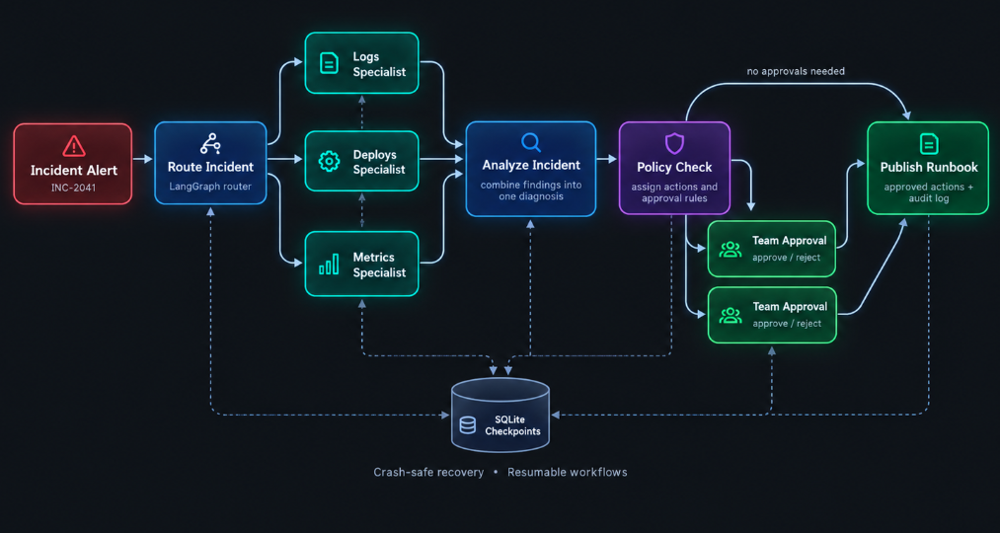
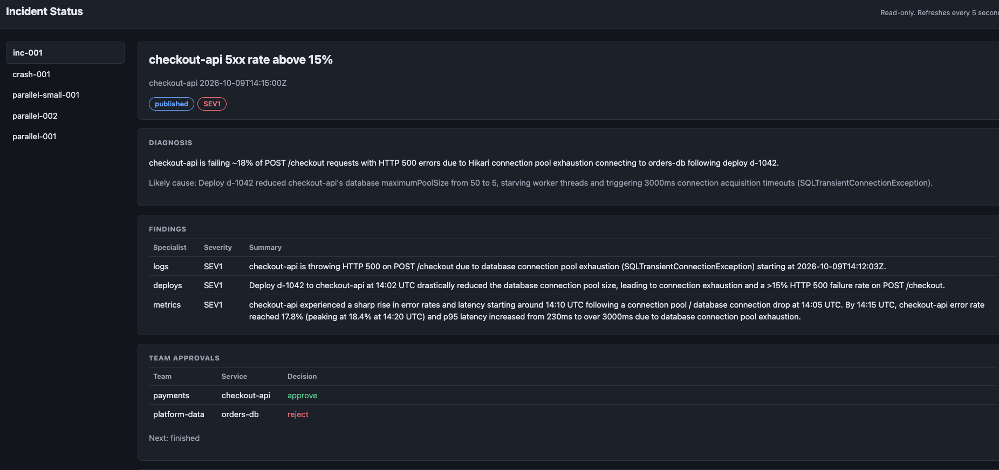

# 🚨 Incident Triage: a Multi-Agent System
 
**Tech Stack:** `Python` · `LangGraph` · `AI Agents` · `Multi-Agent Systems` · `Tool Calling` · `Google Gemini` · `Vertex AI` · `Google Cloud` · `SQLite`
 
---
 
## Problem
 
When a website or app breaks, engineers usually have to dig through three things to find out why: **error logs**, **recent code changes**, and **performance charts**. That takes time while customers are affected.
 
I built a team of **AI agents** that does this investigation automatically. It works like a small incident-response team:
 
- 🧭 **A coordinator** reads the alert, decides how serious it is, and assigns the work.
- 🔍 **Three specialist agents** investigate at the same time, each looking at a different source.
- 🧠 **An analyst** combines what they found into one clear diagnosis and suggests fixes.
- 👥 **Real people stay in control.** Before any risky fix is applied, the responsible team has to approve it.
- 📘 **A final report** is published with the findings, the decisions, and a full record of who approved what.
If the system crashes midway, it **picks up exactly where it left off** and doesn't start over.
 
---
 
## How it works
 

 
Reading the diagram from left to right:
 
1. **Incident Alert:** something goes wrong, for example *"checkout-api error rate above 15%."*
2. **Route Incident:** the coordinator agent sets a severity level (SEV1 = most urgent) and picks which specialists are needed.
3. **Specialists:** up to three agents investigate **in parallel** (see the table below).
4. **Analyze Incident:** all findings are merged into one diagnosis.
5. **Policy Check:** the system decides which fixes are safe and which need a person to sign off.
6. **Team Approval:** the workflow **pauses** until each responsible team approves or rejects its own fix.
7. **Publish Runbook:** a final incident report is written.
Throughout the process, progress is saved to a small database (**SQLite checkpoints**), which is what makes it crash-safe and able to wait for approvals.
 
---
 
## The three specialist agents
 
| Agent | What it looks at | Its tool |
|---|---|---|
| 📜 **Logs Specialist** | Error messages the system recorded | `search_logs` |
| 🚀 **Deploys Specialist** | Recent code and configuration changes | `recent_deploys` |
| 📈 **Metrics Specialist** | Error rates and response times over time | `metric_window` |
 
Each agent has **one tool for one job**. That keeps it focused, makes its answers predictable, and makes it easier to check its work. All three report back in the same format: what they found, the evidence, the likely cause, and how severe it is.
 
---
 
## See it in action: the Incident Status page
 
I also built a **live, read-only status page** where anyone on the team can follow an incident without touching the workflow. It refreshes every 5 seconds.
 

 
This screenshot shows a real run on a sample incident, **"checkout-api 5xx rate above 15%"** (customers were getting errors at checkout):
 
- **Diagnosis:** about 18% of checkout requests were failing. The agents traced this to **deploy d-1042**, which had cut the database connection limit from 50 to 5, so the service ran out of database connections.
- **Findings:** the Logs, Deploys and Metrics specialists each found a different piece of evidence, and all three pointed to the same cause.
- **Team Approvals:** the **payments** team approved its fix, and the **platform-data** team rejected theirs. Each team decides only for its own service.
- **Status:** the incident was marked **SEV1** (most urgent) and the final report was **published**.
The left sidebar lists every saved incident run, including the crash-recovery test (`crash-001`) and the parallel-investigation tests.
 
---
 
## What makes it "agentic"
 
| Skill | Where it shows up |
|---|---|
| **Multi-agent coordination** | A router agent assigns work to specialist agents |
| **Tool calling** | Each agent decides when to use its own tool |
| **Parallel execution** | The specialists investigate at the same time |
| **Structured outputs** | Every agent reports in the same validated format |
| **Human-in-the-loop** | Risky fixes pause for team approval |
| **Guardrails** | A policy check flags severe incidents and risky actions (*delete, restart, production…*) |
| **Durable workflows** | Saved checkpoints allow crash recovery and resuming later |
| **Auditability** | Every decision is recorded in the published report |
 
---
 
## What I built
 
I built this by following NextWork's guided project *Triage Incidents with LangGraph*, starting from its starter code. My work:
 
- Set up Google Cloud and connected the Gemini model through Vertex AI
- Built the three specialist agents and their tools
- Built the LangGraph workflow: routing, parallel investigation, analysis, policy check, approvals and report
- Added crash recovery and tested it by deliberately breaking the Metrics agent mid-run, then resuming
- Added per-team approval steps and tested both approve and reject outcomes
- Built the live Incident Status page
---
 
## Design decisions
 
- **Specialists instead of one big agent:** smaller, focused agents are easier to trust, test and debug.
- **A coordinator that chooses who investigates:** minor incidents don't run every agent, which saves time and cost.
- **Parallel investigation:** the three checks don't depend on each other, so running them together is faster.
- **People approve risky changes:** AI suggests the fix, but a person signs off before production systems are touched.
- **Save progress after every step:** an interruption should never lose or repeat finished work.
---
 
## Under the hood
 
| Layer | Tools |
|---|---|
| Agent orchestration | LangGraph (`StateGraph`, `Send` API, `interrupt`) |
| Agents & tool calling | LangChain (`create_agent`, structured output) |
| AI model | Google Gemini via Vertex AI |
| Saved state | LangGraph SQLite checkpointer |
| Cloud | Google Cloud (Vertex AI, Cloud Shell) |
| Interface | Command-line app + web status page |
 

<details>
<summary><b>Run it yourself</b></summary>

Requires a Google Cloud project with the Vertex AI API enabled. Built and tested in Google Cloud Shell.

```bash
git clone https://github.com/<your-username>/langgraph-multi-agent-incident-triage.git
cd langgraph-multi-agent-incident-triage
python3 -m venv .venv && source .venv/bin/activate
pip install -r requirements.txt

# Investigate the sample incident
python3 app.py start --thread inc-001 --alert INC-2041

# Each team approves or rejects its own fix
python3 app.py resume --thread inc-001 --team payments --decision approve
python3 app.py resume --thread inc-001 --team platform-data --decision reject

# Crash-recovery test
TRIAGE_FAIL=metrics python3 app.py start --thread crash-001 --alert INC-2041
python3 app.py resume --thread crash-001

# Live status page
python3 status_page.py
```

</details>

<details>
<summary><b>Project structure</b></summary>

```text
langgraph-multi-agent-incident-triage/
├── app.py              # The LangGraph workflow + command-line app
├── specialists.py      # The three specialist agents and their tools
├── status_page.py      # Live, read-only Incident Status page
├── requirements.txt    # Dependencies
├── data/               # Sample alerts, logs,
```
</details>

## What's next
 
- **LangSmith tracing** to replay every agent decision step by step
- **Automated evaluations** that test the agents on incidents with known causes and score their accuracy
- **Deploying to the cloud** with Docker so it can connect to real alerting tools
